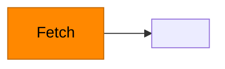

# uapz

A small native node-graph editor built with [gpui-kit](https://gpui-kit.com). Nodes are
empty boxes you drag around and wire together. Graphs save as a Markdown file with a
Mermaid diagram plus a JSON sidecar, and you can define reusable node kinds with a name
and a color.

## Running

```sh
cargo check   # keep it warning-free
cargo run
```

Tests cover the file format and the Mermaid parser:

```sh
cargo test
```

## Using it

The window has a sidebar on the left, a toolbar above the canvas, and the canvas itself.

**Canvas**

- Drag a node to move it. Drag empty space to pan.
- Drag from a node's right-hand port and release on another node to connect them. The
  wire is dashed until it snaps to a target. Self-connections and duplicates are ignored.
- Click a node or a wire to select it. Backspace or Delete removes it. Deleting a node
  removes its wires.
- Double-click empty space, press cmd-n, or click **Add node** to add a node of whatever
  the toolbar dropdown has selected (**Blank** or one of your saved kinds).
- Escape cancels a drag and clears the selection.

**Graphs (sidebar)**

- Type a name and press **Save** (or Enter, or cmd-s) to write `graphs/<name>.md` and
  `graphs/<name>.json`. Saving under a new name acts as Save As.
- Click a saved graph to load it. **New** (cmd-shift-n) clears the canvas.

**Nodes (sidebar)**

- Type a name, pick a color, press **Save node** (or Enter) to save a kind to
  `nodes/<name>.json`.
- In the list, **+** adds one to the canvas, **×** deletes the kind, and clicking the row
  makes it the current kind and loads it into the creator so you can change its color and
  save it again. Nodes already on the canvas recolor when their kind changes.

## Files

`graphs/` and `nodes/` are created next to the executable's working directory on first
save. Both are plain text, so they are easy to commit, diff, or hand-edit.

### `graphs/<name>.md`

Human-readable view of the graph. Node ids are stable, nodes made from a kind carry its
name as the label and a `style` line with its color, and GitHub, VS Code and most
Markdown tools render the block.

````markdown
# pipeline

Layout and node data live in `pipeline.json`.


````

### `graphs/<name>.json`

The full editor state. One object per node with its position, an optional `kind` and
`color` (copied from the kind at save time so the graph still renders if the kind is
deleted), and a free-form `data` object reserved for future per-node content.

```json
{
  "version": 1,
  "name": "pipeline",
  "view": { "pan_x": 0.0, "pan_y": 0.0 },
  "nodes": [
    { "id": "n0", "x": 160.0, "y": 220.0, "kind": "Fetch", "color": "#ff8800", "data": {} },
    { "id": "n1", "x": 460.0, "y": 330.0, "data": {} }
  ],
  "edges": [{ "from": "n0", "to": "n1" }]
}
```

Loading prefers the JSON. If only the `.md` exists, the Mermaid block is parsed for node
ids and `-->` edges (node shapes and `|labels|` are tolerated) and laid out left to right.

### `nodes/<name>.json`

```json
{ "name": "Fetch", "color": "#ff8800" }
```

## Shortcuts

| Keys | Action |
| --- | --- |
| cmd-s, ctrl-s | Save graph |
| cmd-shift-n | New graph |
| cmd-n, ctrl-n | Add node of the selected kind |
| Backspace, Delete | Delete selection |
| Escape | Cancel drag, clear selection |
| cmd-q | Quit |

## Layout

| File | Role |
| --- | --- |
| `src/main.rs` | App setup, key bindings, window |
| `src/sidebar.rs` | Workspace: sidebar, toolbar, kind dropdown |
| `src/graph.rs` | The editor view: nodes, wires, dragging, selection |
| `src/doc.rs` | File formats, Mermaid writer and parser, kind library |

Dependencies are `gpui-kit` (GPUI plus the component library), `serde` and `serde_json`.
