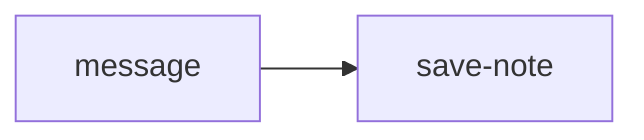

# call-reviewed-note

Layout and node data live in `call-reviewed-note.json`. Copy this pair and the
`reviewed-note` pair into `graphs/`, then open **call-reviewed-note**. **Run all**
asks for `message`, passes it to the child's `note` input, and pauses for review
before writing `generated/note.md`. No model or API key is needed.

Select **save-note** and expand **Show child execution** to see the child run.
Its write review is labeled `n1/n1`: parent Workflow node `n1`, child write node `n1`.

