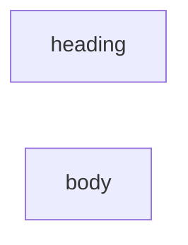

# note-parts

Layout and node data live in `note-parts.json`.

This reusable child publishes two named outputs: `heading` from `n0` and `body`
from `n1`. Both nodes are Run inputs with text defaults. Calling this graph with
an empty Workflow `output` returns both ports in one child execution. It needs
no model or API key and writes no files.

Use the `use-note-parts` example to supply both inputs and review separate files
made from the published outputs.

