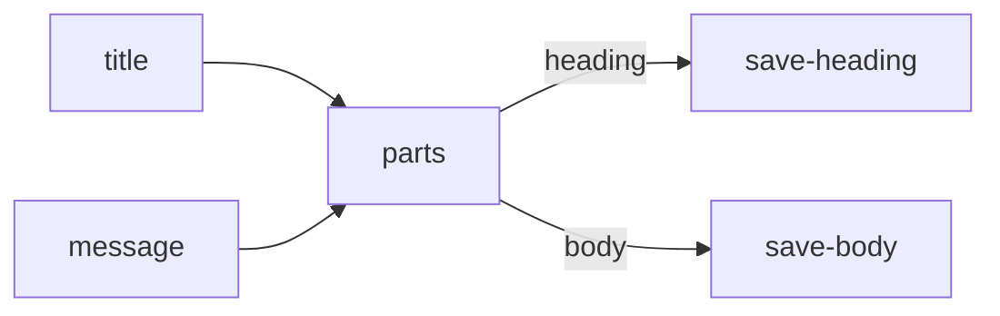

# use-note-parts

Layout and node data live in `use-note-parts.json`. Copy this pair and the
`note-parts` pair into `graphs/`, then open **use-note-parts** and choose
**Run all**. No model or API key is needed.

The Run form asks for `title` and `message`. Workflow node `parts` maps these
values into the child's `heading` and `body` inputs. Its empty `output` selects
the child's published outputs, so both ports come from one child run.

The `heading` wire goes to **save-heading**, which proposes
`generated/heading.md`. The `body` wire goes to **save-body**, which proposes
`generated/body.md`. Review and apply each file independently. Select **parts**
to inspect its named outputs and open the child graph execution.

Named wire handles are `n2.heading` and `n2.body`. An Agent connected to those
ports could also address them as `{{parts.heading}}` and `{{parts.body}}`.

